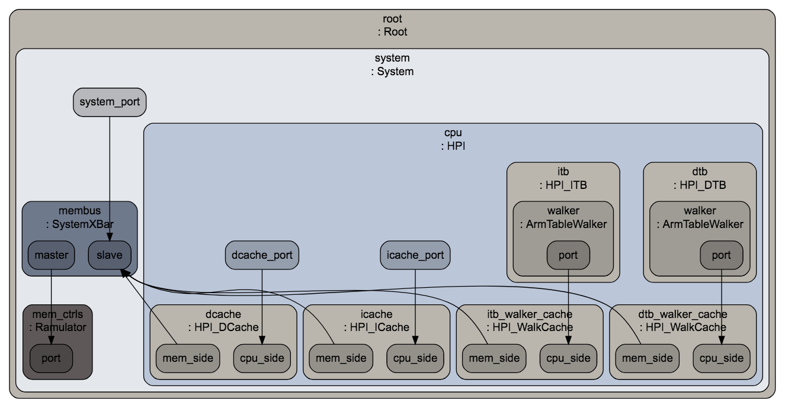

# ARCHI-SEC Installation Guidelines

1. Clone loacally [gem5](https://github.com/gem5/gem5), [ramulator](https://github.com/CMU-SAFARI/ramulator) (main memory simulator), and [simpoint](https://cseweb.ucsd.edu/~calder/simpoint/index.htm) (a methodology to pick representative samples to guide simulation)
```console
foo@bar:~$ git clone --recursive https://gite.lirmm.fr/archi-sec/gem5.git

Cloning into 'gem5'...  
...
Cloning into 'ext/ramulator/Ramulator'...
...
Cloning into 'simpoint'...
...
```

2. Before compilation, make sure the following requirements are met:
- gcc 5 or superior
- g++ 5 or superior
- SCons
- Python3

3. Change directory and compile gem5 + ramulator. Example using 16 threads:
```console
foo@bar:~$ cd gem5
foo@bar:~$ scons ./build/ARM/gem5.opt -j16

scons: Reading SConscript files ...  
...
scons: done building targets.
 ```

4. Test the installation by running a *Hello World* binary onto a 64-bit High-Performance In-order (HPI) arm-based CPU with L1 instruction and data caches, and DDR4 main memory:
```console
foo@bar:~$ build/ARM/gem5.opt configs/example/se.py --cpu-type=HPI --caches --mem-type=Ramulator --ramulator-config=ext/ramulator/Ramulator/configs/DDR4-config.cfg --cmd=tests/test-progs/hello/bin/arm64/hello

gem5 Simulator System.  http://gem5.org  
gem5 is copyrighted software, use the --copyright option for details.  

gem5 compiled Jun 21 2020 12:09:12  
gem5 started Jun 21 2020 12:42:48  
gem5 executing on muse029.cluster, pid 123571  
command line: build/ARM/gem5.opt configs/example/se.py --cpu-type=HPI --caches --mem-type=Ramulator --ramulator-config=ext/ramulator/Ramulator/configs/DDR4-config.cfg --cmd=tests/test-progs/hello/bin/arm64/hello  

Global frequency set at 1000000000000 ticks per second  
warn: failed to generate dot output from m5out/config.dot  
warn: No functional unit for OpClass SimdDiv  
warn: No functional unit for OpClass SimdReduceAdd  
warn: No functional unit for OpClass SimdReduceAlu  
warn: No functional unit for OpClass SimdReduceCmp  
warn: No functional unit for OpClass SimdFloatReduceAdd  
warn: No functional unit for OpClass SimdFloatReduceCmp  
warn: No functional unit for OpClass SimdAes  
warn: No functional unit for OpClass SimdAesMix  
warn: No functional unit for OpClass SimdSha1Hash  
warn: No functional unit for OpClass SimdSha1Hash2  
warn: No functional unit for OpClass SimdSha256Hash  
warn: No functional unit for OpClass SimdSha256Hash2  
warn: No functional unit for OpClass SimdShaSigma2  
warn: No functional unit for OpClass SimdShaSigma3  
warn: No functional unit for OpClass SimdPredAlu  
0: system.remote_gdb: listening for remote gdb on port 7000  
**** REAL SIMULATION ****  
info: Entering event queue @ 0.  Starting simulation...  
Hello world!
Exiting @ tick 17850000 because exiting with last active thread context  

 ```

5. Check the simulation results (i.e., *stats.txt*) and the simulated architecture (i.e., *config.dot*) in the *m5out* directory:

First lines of *stats.txt*:
```console
---------- Begin Simulation Statistics ----------  
final_tick                                   17850000                       # Number of ticks from beginning of simulation (restored from checkpoints and never reset)  
host_inst_rate                                  70762                       # Simulator instruction rate (inst/s)  
host_mem_usage                                 880168                       # Number of bytes of host memory used  
...
 ```
 Visualization of *config.dot*:


# gem5 README

The main website can be found at http://www.gem5.org

A good starting point is http://www.gem5.org/about, and for
more information about building the simulator and getting started
please see http://www.gem5.org/documentation and
http://www.gem5.org/documentation/learning_gem5/introduction.

To build gem5, you will need the following software: g++ or clang,
Python (gem5 links in the Python interpreter), SCons, SWIG, zlib, m4,
and lastly protobuf if you want trace capture and playback
support. Please see http://www.gem5.org/documentation/general_docs/building
for more details concerning the minimum versions of the aforementioned tools.

Once you have all dependencies resolved, type 'scons
build/<ARCH>/gem5.opt' where ARCH is one of ALPHA, ARM, NULL, MIPS,
POWER, SPARC, or X86. This will build an optimized version of the gem5
binary (gem5.opt) for the the specified architecture. See
http://www.gem5.org/documentation/general_docs/building for more details and
options.

The basic source release includes these subdirectories:
   - configs: example simulation configuration scripts
   - ext: less-common external packages needed to build gem5
   - src: source code of the gem5 simulator
   - system: source for some optional system software for simulated systems
   - tests: regression tests
   - util: useful utility programs and files

To run full-system simulations, you will need compiled system firmware
(console and PALcode for Alpha), kernel binaries and one or more disk
images.

If you have questions, please send mail to gem5-users@gem5.org

Enjoy using gem5 and please share your modifications and extensions.
